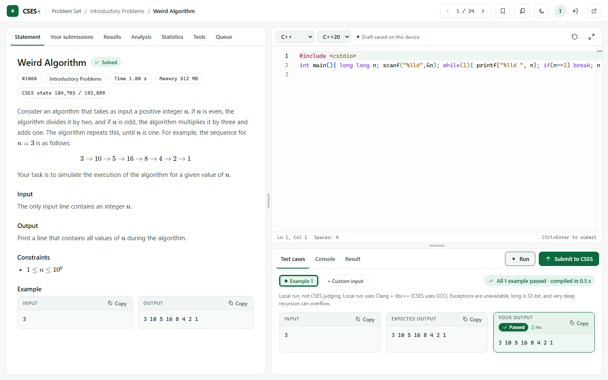
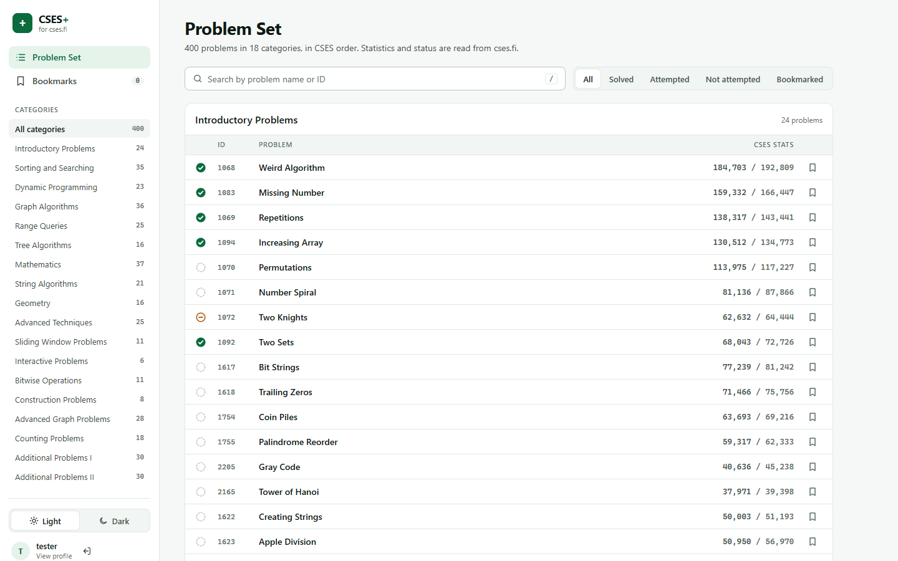
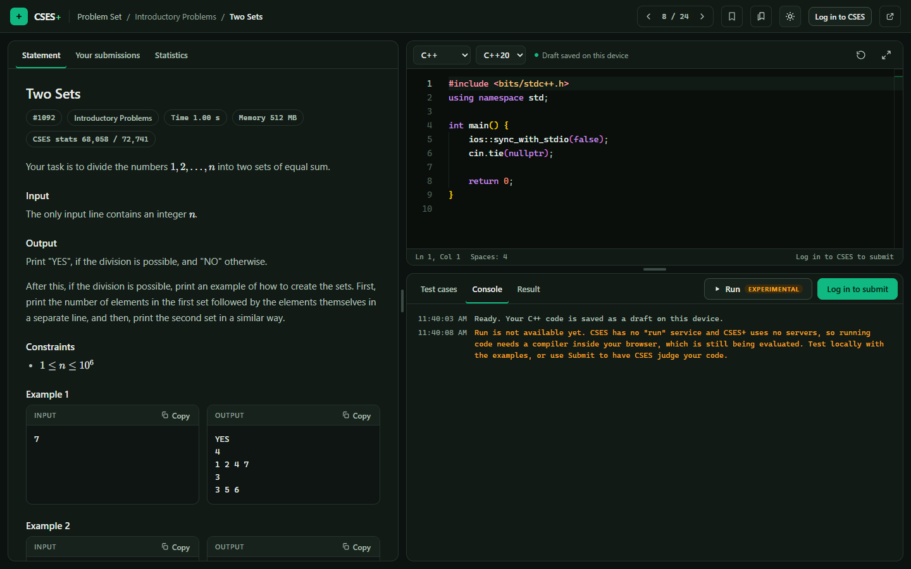

# CSES+

**A modern, LeetCode-style interface for the [CSES Problem Set](https://cses.fi/problemset/) — with a code editor, one-click submit, and a Run button that compiles your code right in the browser.**

CSES+ is a free, open-source Chrome extension. It works *on top of* cses.fi: your CSES account, submissions and verdicts stay exactly where they are. No servers, no accounts, no tracking.



<table>
<tr>
<td></td>
<td></td>
</tr>
<tr>
<td align="center">Problem Set with search, filters and solved status</td>
<td align="center">Dark mode, synced with your CSES setting</td>
</tr>
</table>

---

## Features

- **Problem Set:** search by name or ID, category sidebar, filters (Solved / Attempted / Not attempted / Bookmarked), solved icons from your CSES account.
- **Workspace:** problem statement on the left, [Monaco](https://microsoft.github.io/monaco-editor/) (the VS Code editor) on the right. Resizable in both directions; drafts are saved automatically per problem and language.
- **Run:** compiles or interprets your code **inside the browser** and checks it against the examples from the statement, plus your own custom input. Passed is green, wrong output is red with the first differing line, time limits are orange.
- **Submit:** one click (or `Ctrl+Enter`) submits through CSES's own submit form, with your normal CSES login.
- **Bookmarks:** saved on your device only.
- **Whole site:** results, statistics, profiles, courses, contests and the home page all get the same clean layout.
- **Light / dark theme:** uses CSES's own dark-mode setting, so CSES and CSES+ always match.
- **Safe:** if anything looks unexpected, CSES+ steps aside and shows the original page. "Original page" in the top bar turns it off for that tab.

### Run: supported languages

| Language | Runs with | Notes |
| --- | --- | --- |
| C++ (C++11 / 17 / 20 / 23) | Clang 22 (WebAssembly) | First run per C++ version prepares `bits/stdc++.h` (~20–40 s, cached after; then ~1–2 s) |
| C (C99) | Clang 22 (WebAssembly) | |
| Python 3 | Pyodide (CPython 3.12) | PyPy isn't available locally |
| Ruby | ruby.wasm 3.2 | |
| Node.js | QuickJS + Node shim | `fs.readFileSync(0)`, `readline`, `process.stdin/stdout`, `console` |

Java, Rust, Haskell, Pascal, Scala, Assembly, Python 2 and Make have no working in-browser runtime yet — Run says so, and Submit works as normal.

> **Local Run is not CSES judging.** It uses a different compiler and machine. C++ differences: Clang + libc++ instead of GCC, no `try`/`throw`, `long` is 32-bit, no pb_ds, and very deep recursion (~10,000+ levels) can overflow the browser's stack. Always Submit for the real verdict.

---

## Install

### Option A — download a release (no tools needed)

1. Go to the [Releases](../../releases) page and download `csesplus-vX.Y.Z.zip`.
2. Unzip it into a folder you'll keep (for example `Documents/csesplus`).
3. Open `chrome://extensions` in Chrome (or Edge: `edge://extensions`).
4. Turn on **Developer mode** (top right).
5. Click **Load unpacked** and select the unzipped folder (the one containing `manifest.json`).
6. Open <https://cses.fi/problemset/> — done.

### Option B — build from source

Requirements: [Node.js](https://nodejs.org/) 20 or newer and Git.

```sh
git clone https://github.com/<your-username>/csesplus.git
cd csesplus
npm install
npm run build
```

Then load the `dist/` folder with **Load unpacked** (steps 3–5 above).

To update later: `git pull`, `npm install`, `npm run build`, then click the reload icon on CSES+ in `chrome://extensions`.

---

## Usage

| Action | How |
| --- | --- |
| Search problems | Type in the search box (`/` focuses it) |
| Run on the examples | **Run** button or `Ctrl+'` in the editor |
| Add your own input | **+ Custom input** in the Test cases tab |
| Submit to CSES | **Submit to CSES** or `Ctrl+Enter` in the editor |
| Previous / next problem | Arrows in the top bar, or `Alt+←` / `Alt+→` |
| Bigger editor | Expand button in the editor toolbar (`Esc` to restore); drag the handles to resize |
| Original CSES page | External-link button in the top bar (turns CSES+ off for that tab) |

---

## Privacy

- The only permission is `storage`, and CSES+ only runs on `https://cses.fi/*`.
- No servers, analytics or tracking. Your code never leaves your browser; Run happens locally.
- Bookmarks, drafts and settings are stored in your browser only and are never synced.
- Submissions go through CSES's own form with your existing CSES session. CSES+ never sees or stores your password.

---

## How it works

| Part | Where | What it does |
| --- | --- | --- |
| Content scripts | `src/content/` | Read the CSES page, build the CSES+ interface, and move CSES's own content into it |
| CSES selectors and parsers | `src/core/selectors.ts`, `src/core/parse.ts` | Every CSES selector in one place; HTML → data, unit-tested on real pages |
| Editor | `src/editor/` | Monaco in an extension iframe (its own origin and security policy) |
| Run engine | `src/run/` | One Web Worker per language; compilers and interpreters compiled to WebAssembly and packaged with the extension |
| Submit | `src/content/submit.ts` | Fills CSES's real submit form (language, version, file) and submits it |

More detail: [docs/run-feasibility.md](docs/run-feasibility.md) (Run research and measurements) and [docs/CSES-Plus-Interview-Prep.pdf](docs/CSES-Plus-Interview-Prep.pdf) (full technical write-up).

---

## Development

```sh
npm install
npm run watch        # rebuilds dist/ on every change; reload the extension in chrome://extensions
npm run typecheck
npm test             # parser tests against saved CSES pages (tests/fixtures)
```

End-to-end tests drive a real Chrome against cses.fi. Branded Chrome no longer accepts `--load-extension`, so they use Chrome for Testing:

```sh
npx @puppeteer/browsers install chrome@stable
CHROME_PATH=/path/to/chrome node scripts/smoke.mjs       # pages, theme, bookmarks, submit (simulated login)
CHROME_PATH=/path/to/chrome node scripts/smoke-run.mjs   # Run in every supported language
```

The tests only load public pages; logged-in pages are simulated from scrubbed fixtures, and nothing is ever submitted to CSES.

### Making a release zip

```sh
npm run build
# Windows 10+ and macOS (built-in bsdtar writes a standard zip)
tar -a -cf csesplus-v0.1.0.zip -C dist .
# Linux
cd dist && zip -r ../csesplus-v0.1.0.zip . && cd ..
```

Upload the zip to a GitHub Release (about 45 MB, well within GitHub's 2 GB per-file release limit). Don't commit it: `dist/` and zips are git-ignored.

---

## Contributing

Issues and pull requests are welcome. If CSES changes its pages, the fix usually belongs in `src/core/selectors.ts` plus a new fixture in `tests/fixtures/`. Please run `npm run typecheck` and `npm test` before opening a pull request.

## License

[MIT](LICENSE). CSES+ is an independent project and is not affiliated with CSES. Problem statements belong to CSES and are licensed CC BY-NC-SA 4.0; CSES+ displays them from cses.fi and does not copy or redistribute them. Bundled runtimes keep their own licenses (Clang/LLVM: Apache-2.0 with LLVM exception; Pyodide: MPL-2.0; ruby.wasm: MIT; QuickJS: MIT; Monaco: MIT).
